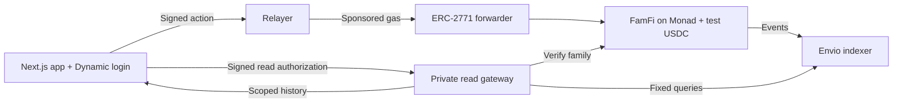

# Fam-Fi

### Family money today. Confidence with crypto tomorrow.

**A teen’s first crypto experience should begin with someone they trust.**

Fam-Fi onboards teens to crypto through allowance, earning, paying friends, and saving—with their family beside them. Parents set the boundaries, teens gain useful independence, and relatives can reward saving with matching gifts.

Built for **Monad Metropolis · Track 02: Consumer Products & Payments**.

[Explore the app](https://fam-fi.vercel.app) · [Contract deployment evidence](deployments/monadTestnet.json)

## Why families—and why crypto?

Creating a wallet is only the beginning. Allowance gives a teen a reason to return; missions give them a way to earn; goals give them something to work toward. Fam-Fi turns those familiar moments into signed, on-chain actions without requiring wallet addresses or gas tokens for everyday use.

**The journey: join → receive → earn → pay → save → understand → grow.**

Our ambition is to help teens build confidence for independent crypto use as they grow. Learning outcomes, retention, and an adult-account transition are future work.

## How it works

1. **Parent starts a family:** email sign-in, readable Fam-ID, and a signed teen invitation containing parent-chosen limits and payment protections.
2. **Teen joins:** an embedded wallet sits behind a familiar login; optional passkeys help them return.
3. **Family funds the experience:** add test funds or deposit personal-wallet test USDC, then allocate allowance, rewards, or future savings.
4. **Teen takes action:** earn, pay, request, split, and save. Smart contracts enforce the rules; a relayer sponsors gas for normal Fam-Fi actions.
5. **Everyone sees progress:** confirmed receipts become readable activity, a teen’s Progress Passport, and a parent’s Weekly Brief.

## Features

| Feature | What families get |
|---|---|
| **Allowance & limits** | Allowance accrues by the second. Parents choose daily limits by level and can freeze spending while saving and incoming funds remain available. |
| **Payments, requests & splits** | Pay registered Fam-IDs, share pay codes, request money, and split costs. |
| **Scam Shield & inbox** | Configurable new-payee and first-day protections hold unusual payments; over-limit payments also need review. One inbox brings together holds, requests, goals, and mission submissions. |
| **Funded missions** | Parents reserve rewards before work starts. Teens submit or resubmit after feedback; approval pays once, optionally into a linked goal. Eligible cancellations and expiry return reserved funds. |
| **Goals & matching gifts** | Teens propose goals; parents approve. Parents or permitted relatives fund matching gifts that unlock as the teen saves. Optional round-ups add spare change; completed goals can pay a Fam-ID. |
| **Progress Passport & Weekly Brief** | Source-linked milestones and weekly summaries count confirmed activity, with replay protection and family time-zone boundaries. No credit score. |
| **FutureFund** | Family contributions stay locked until the intended date or early release. Teens see the money story and claim when eligible. **No investment or yield.** |
| **Scoped family reads** | Signed read authorization checks roles and family membership; relatives cannot access a teen’s private family summaries. Blockchain events remain public. |

## Why on-chain?

The commitments are enforceable: **invites carry the rules, mission rewards are reserved, matching gifts are funded, and progress has transaction evidence.** The frontend explains the contract’s decisions; it cannot override them.



- **Monad:** EVM execution for the family ledger, payments, rewards, goals, and locked funds.
- **Dynamic:** email onboarding, embedded wallets, and optional passkeys.
- **Envio:** confirmed event history, Passport evidence, and weekly aggregates.
- **Contracts + relayer:** user-signed actions, sponsored gas, and custody reconciliation across balances and reserved funds.

## Bounty integrations & code

Our submission focuses on **Monad’s Consumer Products & Payments track**, with **Dynamic** for onboarding and **Envio** for the evidence behind family progress.

| Track / bounty | How we used it | Implementation |
|---|---|---|
| **Monad — Consumer Products & Payments** | Family allowance, Fam-ID payments, spending protections, funded missions, matching gifts, and FutureFund execute on Monad testnet. Users sign actions; our relayer sponsors normal app transactions. | [Family ledger & rules](contracts/src/FamFi.sol) · [ERC-2771 forwarder](contracts/src/FamFiForwarder.sol) · [Signing & relay client](app/src/lib/relay.ts) · [Relayer verification & submission](relayer/src/app.ts) |
| **Dynamic — onboarding & embedded wallets** | Headless email OTP login, embedded-wallet creation, optional passkeys, Monad network switching, and wallet signing. The personal-wallet funding flow authorizes test USDC before depositing it; family-summary access uses a separate read-only signature. | [SDK integration](app/src/lib/dynamic-shell.tsx) · [Wallet funding](app/src/lib/wallet-funding.ts) · [Funding UI](app/src/components/wallet-funding.tsx) · [Read session](app/src/lib/read-session.ts) |
| **Envio — indexed history & progress** | HyperIndex handlers correlate mission rewards, saving, and matching by transaction. `SavingReceipt`, `SavingContribution`, and `MatchRelease` explain how a goal grew; `Achievement`, `TeenProgress`, and `WeeklyStat` power milestones and summaries. Source-log identities prevent duplicate counting. | [Indexer configuration](indexer/config.yaml) · [Schema](indexer/schema.graphql) · [Event handlers](indexer/src/EventHandlers.ts) · [Savings story](app/src/components/saving-story.tsx) · [Passport](app/src/components/passport.tsx) · [Weekly Brief](app/src/components/brief.tsx) |

**Integration proof:** [local full-stack flow](relayer/scripts/missions-flow.ts), [funding tests](app/src/lib/wallet-funding.test.ts), [read-session tests](app/src/lib/read-session.test.ts), and [indexer tests](indexer/test/missions.test.ts). Family summaries pass through the [authenticated gateway](relayer/src/private.ts). Gas sponsorship is provided by Fam-Fi’s relayer; Dynamic supplies wallet access and signatures. The local indexer uses Envio’s TestIndexer harness; hosted HyperIndex operation and the complete live signing journey remain pending as noted below.

## Judge walkthrough

Show parent and teen sessions side by side:

**Invite & join → add funds & allowance → create, submit & approve a mission → approve a goal, lock a match & save → pay, request & split → review a hold & demonstrate freeze → contribute to FutureFund → open Passport & Weekly Brief.**

For money-moving steps, show the **confirmed receipt and resulting balances or state**. A held payment is not a settled payment; token authorization is not a deposit. Use actual receipt timings when demonstrating speed.

## Deployment & validation

- **Frontend:** [fam-fi.vercel.app](https://fam-fi.vercel.app), Vercel project `fam-fi`; production build passed and homepage returned HTTP 200 at deployment verification.
- **Network:** Monad testnet, chain ID **10143**. Deployment recorded **13 October 2026**, starting at block **70640050**.
- **FamFi:** `0x9B4753f628b1D4445C9C29EC8608E3ec78D2FbE9`
- **Forwarder:** `0xbA73C0EA819e6aB3C65Dc5b867205Bf873dBcF5b`
- **Test USDC:** `0x534b2f3A21130d7a60830c2Df862319e593943A3`
- **Evidence:** [deployment transactions and recorded bytecode verification](deployments/monadTestnet.json). Contract replacement does not automatically migrate families or balances.
- **Checks included:** contract authorization and custody invariants; mission lifecycle and replay protection; authenticated family scopes; indexer aggregation; local integration flows; frontend types, builds, and sign-in rendering.
- **Still pending:** public backend hosting, durable hosted indexing, and a complete recorded two-account Dynamic walkthrough. Local integration tests use temporary accounts and a mock token; they do not prove hosted operation or real-user signing.

## Run locally

Requires **Node.js 22.15+**, npm, a Dynamic sandbox environment, and Monad test tokens for service wallets.

```bash
git clone https://github.com/Naveen-807/Fam-Fi.git
cd Fam-Fi
node scripts/install-all.mjs
node scripts/new-wallets.mjs
node scripts/wallet-status.mjs
# Fund the printed service addresses before deploying.
node scripts/deploy-testnet.mjs --dry-run --dynamic-env <environment-id>
node scripts/deploy-testnet.mjs --dynamic-env <environment-id>
node scripts/start-testnet.mjs
```

Open the printed app URL (default: `http://localhost:3000`). Use the [Monad](https://faucet.monad.xyz) and [Circle](https://faucet.circle.com) faucets for test MON and test USDC. The treasury faucet requires test USDC and a configured token allowance. Keep `.wallets.json` and service keys out of Git and frontend configuration.

Enable email sign-in and EVM embedded wallets in Dynamic, plus passkeys if used. Add the frontend origin. Configuration references: [app/.env.example](app/.env.example) and [relayer/.env.example](relayer/.env.example).

**Public hosting:** deploy the relayer and a durable indexer against the same contracts; set the relayer’s `ENVIO_URL`, the app’s `NEXT_PUBLIC_RELAYER_URL`, and allowed origins in Dynamic and the relayer. Keep private family queries behind the gateway. Rebuild after changing public environment values. Vercel builds from `app/` with shared `abi/` files included; localhost endpoints cannot serve visitors.

## Run checks

```bash
(cd contracts && npx hardhat test)
(cd relayer && npm run test:private && npm run test:flow)
(cd indexer && npm test)
(cd app && npm run typecheck && npm run build)
(cd e2e && npm install --legacy-peer-deps && node dynamic-ui.mjs)
```

**Repository:** `app/` frontend · `contracts/` Solidity & tests · `relayer/` transactions & private reads · `indexer/` Envio handlers · `abi/` shared interfaces · `scripts/` setup & deployment · `deployments/` evidence · `e2e/` browser checks.


## Disclosure & license
Judge the implementation by its source, tests, deployment records, and demonstrated outcomes. Licensed under [MIT](LICENSE).
